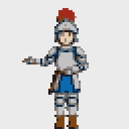
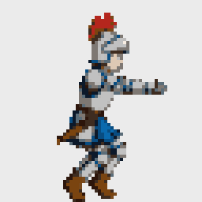
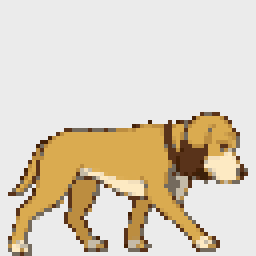
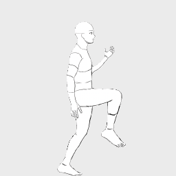
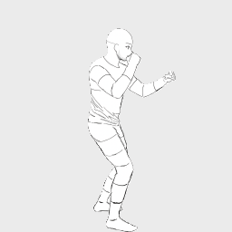

# ActSprite — Act it out. Play it in.

[](README.zh-TW.md)

> Hackathon: Meta Global AI Developer Hackathon · Track: Indie Developer · Theme: **Build for Your World**

Act out a move on your phone. Get a consistent, game-ready animated character in Unity.

**Status:** work in progress. The command line runs the whole pipeline and the Unity importer turns its ZIP into a
playable character; the full web flow comes next.

## For judges: verify in 2 minutes (no API key)

**1. Look at finished output.** Each ZIP is exactly what the pipeline hands to Unity:

| Pixel knight, dance (front view, 48 frames) and jump (12 frames) | Pixel hound, walk | Line-art man, run (20 frames) and attack |
| --- | --- | --- |
|   |  |   |
| [Download ZIP](https://github.com/lilwad-0730/actsprite/raw/main/examples/actsprite_knight.zip) | [Download ZIP](https://github.com/lilwad-0730/actsprite/raw/main/examples/actsprite_hound.zip) | [Download ZIP](https://github.com/lilwad-0730/actsprite/raw/main/examples/actsprite_lineman.zip) |
| Dance: 40/48 frames passed every check | 4/10 | run 16/20, attack 6/10 |
| Dance: $3.07 in Meta API calls | $1.01 | $1.21 + $0.53 |

The knight jump is an additional GIF preview; the knight ZIP contains the dance only.

Inside each ZIP: the sprite sheet, `<name>_meta.json` for the Unity importer, every frame as a PNG, a GIF
preview, and `report/scores.csv` with the scores of every redraw attempt (`needs_review` marks the frames that did
not pass every check). The spend is the sum of every paid call behind each ZIP in `logs/cost.csv`: the SAM 3.1
video track, the character sheet and every redraw and check. A 10-frame action takes about 4-6 minutes
(measurements in `spikes/REPORT.md`); the 48-frame dance took 15 minutes. The hound and line-art ZIPs were
remade on Oct 31 at 10 frames / 15 fps; their spend counts new calls only (the SAM 3.1 track and some redraws
came from the cache). The line-art run was added on Nov 1 at 20 frames / 20 fps.

**2. Run the tests.** No key and no network needed; `tests/test_examples.py` checks the three ZIPs against the
output contract.

```powershell
python -m venv .venv
.venv\Scripts\python -m pip install -r requirements.txt
.venv\Scripts\python -m pytest
```

## How it works

| Step | Meta model | Job |
| --- | --- | --- |
| Capture | SAM 3.1 (`sam-3.1`) | Track the actor in the clip, pixel masks per frame |
| Redraw | Muse Image (`muse-image-1.0`) | Redraw each pose as your character, anchored to the approved first frame so frames 1-7 are drawn at once |
| Verify | Muse Spark 1.3 (`muse-spark-1.3`) + SAM 3.1 | Art-director critic scores identity; SAM re-checks the pose silhouette |

## Quick start (dev)

```powershell
python -m venv .venv
.venv\Scripts\python -m pip install -r requirements.txt
copy .env.example .env   # then paste your Meta Model API key into .env
.venv\Scripts\python -m pytest
```

## One command per action

```powershell
.venv\Scripts\python -m actsprite samples/attack.MOV --action attack --edges left,right             # pixel knight
.venv\Scripts\python -m actsprite samples/pet.mp4 --action walk --actor dog --character hound         # pixel hound
.venv\Scripts\python -m actsprite my_jump.mp4 --action jump --sheet my_hero.png --style lineart --name hero
.venv\Scripts\python -m actsprite dance.mp4 --action dance --mode span --view front --frames 48 --edges top,bottom,left
```

Each run tracks the actor with SAM 3.1, picks evenly timed keyframes (one burst for jump/attack, one loop for idle,
one two-step stride for walk/run), draws pose guides, redraws every frame as the character with Muse Image
and checks it (SAM 3.1 silhouette, Muse Spark 1.3 critic, palette, leg motion), redrawing failed frames up to
twice. Frames after frame 0 are drawn at the same time, anchored to the approved frame 0. The result is added as a row
to `out/<name>/actsprite_<name>.zip`:

```
actsprite_<name>/
  <name>_sheet.png                 one row per action, fixed cells (pixel art 128 px, other styles 256 px)
  <name>_meta.json                 cell size, feet pivot (0.5, 0), and per action: row, frames, fps, loop
  frames/<action>/<action>_00.png  every frame as its own PNG
  preview/<action>.gif
  report/scores.csv                every redraw attempt with its scores; needs_review marks frames to check
  report/summary.md
  reference/character_sheet.png
  reference/character_sheet_front.png   only when an action was drawn with --view front
```

Keyframes preserve the selected clip's relative timing, including pauses. Loops leave out the repeated
end pose; one-shot actions include both endpoints. Source-frame rounding is at most half a frame.
`--fps auto` follows the clip's timing; a numeric `--fps` deliberately changes its playback speed.
GIF previews distribute their 10 ms timing increments across frames to avoid accumulating playback drift.
The evaluation below uses previously saved runs; image quality has not been remeasured with this sampling change.

Options for moves filmed facing the camera, such as a dance:

- `--view front` draws the character facing the viewer. One extra Muse Image call turns the side-view sheet
  into a front-view sheet of the same design.
- `--mode span` spreads the frames evenly over the whole clip, or over `--start`/`--end` (seconds), instead of
  picking one burst or one loop.
- `--frames N` draws N frames (2-48, default: idle 8, other actions 10). Each frame costs about $0.03-0.10 with its redraws.
- `--fps` sets the playback speed (1-30), or `auto` to play as fast as the clip. Defaults: idle 8, other
  actions 15, span `auto`.
- `--head-turn` also tracks the actor's face with SAM 3.1 (about $0.04), so the drawn head turns the same way:
  facing the viewer, turned slightly, three-quarter, profile, or away. The pose guide gets a flat face patch
  (shape only, no features) and the redraw and the critic get one sentence. On by default with `--view front`.
- `--sample-fps` sets how many frames per second SAM 3.1 tracks (1-60, default 30, never more than the clip
  has). Raise it for fast, complex moves filmed at 60 fps.

The estimated cost is printed before each batch of calls and every call is logged in `logs/cost.csv`
(about $0.7 per action for the three examples; identical requests are served from `cache/` for free). Set `ACTSPRITE_OFFLINE=1`
to answer only from the cache: no key needed, nothing is ever sent to the API.

## Evaluation

A small development check on the author's clips (Nov 1), with every number from a recorded run; details,
caveats and commands in [eval/README.md](eval/README.md).

| Model | Measured result |
| --- | --- |
| Muse Image + verification loop | 79% of 68 keyframes pass every check, vs 32% when each frame is drawn once without the frame-0 anchor (E1) |
| Muse Spark 1.3 critic | rejected 14 of 19 deliberately broken frames (recolour 5/5, missing part 5/5, extra item 4/4, wrong proportions 0/5) and 1 of 19 good ones (E6) |
| SAM 3.1 | a mask in at least 90% of the frames in 9 of 10 clips (E4) |
| Cost | about $0.5–1.0 for the first run of an 8–12 frame action (E3) |

## Unity

The importer is a Unity 6 package in [`unity/ActSpriteImporter`](unity/ActSpriteImporter/README.md).

1. Window > Package Manager > + > *Install package from git URL…*
   `https://github.com/lilwad-0730/actsprite.git?path=unity/ActSpriteImporter`
   (or *Install package from disk…* and pick `unity/ActSpriteImporter/package.json` in a clone).
2. **ActSprite > Import ZIP…** and pick any ZIP above. It slices the sheet (pivot at the feet), makes one clip
   per action at its fps, an Animator Controller (`Speed`, `IsGrounded`, one trigger per extra action) and a
   prefab with a Rigidbody2D and a collider fitted to the character's pixels.
3. **ActSprite > Build Demo Scene**, then Play. The scene starts with a pixel knight bundled in the package
   (idle, run, jump, attack), so there is always a character that runs; your imported characters follow.
   A/D move, Space jumps, 1–9 play extra actions such as attack or dance, Tab switches character.

Checked by a script in a new, empty Unity 6000.5.5f1 project (old Input Manager, then Input System only):
the three example characters import without warnings, every clip has evenly spaced keys at its fps, the
bundled knight switches from idle to run when `Speed` > 0.1 and plays `run_00`–`run_07` in order, and each
character dropped onto the floor and two platforms comes to rest with its lowest foot pixel exactly on the
surface (0 px gap). The author also checked it by hand in Play Mode (2026-10-31).

## Web app

Live: https://huggingface.co/spaces/Andy0730huggin/actsprite. Upload a phone clip, pick a character (built-in or
your own design) and an action, then go through three checked steps: **1. Track** (SAM 3.1 only, about $0.02:
see the keyframes as pose guides), **2. First frame** (draw and check frame 0), **3. All frames** (preview, every
frame with its result, and the ZIP for the Unity importer). The settings used are shown and written to
`report/parameters.json` in the ZIP. Set **Start at** and, optionally, **End at** to select up to 5 s of your clip.
For jump/attack, an end time uses the whole selected part; leaving it empty picks the most active burst.
For idle/walk/run, a cycle is found inside the selected part. Walk/run need at least two full strides;
cycle detection can still fail on short clips or small changes in sampling.

| Action | Frames (up to) | Playback |
| --- | --- | --- |
| idle | 8 | 8 fps |
| walk / run | 16 | Timed from the source clip |
| jump | 12 | Timed from the source clip |
| attack | 10 | 15 fps |

Tracking samples up to 30 fps. **Name** sets the ZIP filename and the character name inside it; **Rename the ZIP
(free)** repacks a finished result without any Meta API calls. Names use letters, digits, `-` and `_`, up to
32 characters; spaces become underscores and other characters are removed.

Each visitor has 5 tracking steps and 2 sprite runs per day. Calls stop at $40 in the Space's current cost log;
the log and daily counters can reset when the Space restarts, so this is not a persistent billing limit.
Other settings remain locked on the web and available in the command line.

Local three-step runs on Nov 1: jump 7/12 frames passed ($0.80), run 9/16 ($1.58), and attack 4/10 ($0.947636).
These are development checks, not accuracy guarantees; jump/run predate the latest capture fixes. The attack
run used a correctly oriented clip after the rotation fix: narrow stances still became wide lunges, so inspect
the preview and amber frames before using the sprites. The earlier 8-frame web run ($0.57; 21/76/141 s for
the three steps) used the old defaults and is not a timing measurement for these presets.

```powershell
.venv\Scripts\python -m pip install gradio==6.31.0 spaces huggingface_hub
.venv\Scripts\python app.py                    # local, http://localhost:7860
.venv\Scripts\hf auth login                    # once, token stays on your machine
.venv\Scripts\python scripts/deploy_space.py   # upload app.py, actsprite/, showcase/, characters/ to the Space
```

## Built during the hackathon (Oct 26 – Nov 4, 2026)

Everything in this repository was created during the hackathon period. See the git history.
The line-art character design (`man in line.jpg`) was drawn for this project on 2026-10-29 by the girlfriend of the author.
The dungeon wall and floor in the Unity demo scene (`unity/ActSpriteImporter/DemoArt/`) were made by the author
on 2026-10-30 with an AI image generator; the prompts are in `DemoArt/GenerationPrompts.md`.
The only outside input is the test footage listed under Credits.

## Credits and licenses

| Package | License | Use |
| --- | --- | --- |
| [openai](https://github.com/openai/openai-python) | Apache-2.0 | Client for the OpenAI-compatible Meta Model API |
| [meta-sam-parser](https://pypi.org/project/meta-sam-parser/) | SAM License (Meta) | Official parser for SAM 3.1 segmentation output |
| [opencv-python-headless](https://github.com/opencv/opencv-python) | Apache-2.0 | Frame extraction, edges, mask ops |
| [NumPy](https://numpy.org) | BSD-3-Clause | Arrays |
| [Pillow](https://python-pillow.org) | MIT-CMU | Image I/O, palette, packing |
| [python-dotenv](https://github.com/theskumar/python-dotenv) | BSD-3-Clause | Load `.env` |
| [pytest](https://pytest.org) | MIT | Tests |
| [Gradio](https://github.com/gradio-app/gradio) | Apache-2.0 | Web app (`app.py`), installed by the Space from `sdk_version` |
| [spaces](https://pypi.org/project/spaces/) | Apache-2.0 | Hugging Face ZeroGPU hosting hook (the app runs on CPU) |
| [huggingface_hub](https://github.com/huggingface/huggingface_hub) | Apache-2.0 | `scripts/deploy_space.py` uploads the app to the Space |
| [2D Sprite](https://docs.unity3d.com/Packages/com.unity.2d.sprite@1.0/manual/index.html) (Unity) | Unity Companion License | Unity importer: slices the sheet through the Sprite Editor Data Provider API |
| [Input System](https://docs.unity3d.com/Packages/com.unity.inputsystem@1.19/manual/index.html) (Unity, optional) | Unity Companion License | Keyboard control when the project uses the Input System |

| Footage | Source | License | Use |
| --- | --- | --- | --- |
| `samples/pet.mp4` (not in the repo) | [Close-Up Shot of Dog Walking on the Street](https://www.pexels.com/video/close-up-shot-of-dog-walking-on-the-street-4300700/) by Luis Adolfo Burgos, Pexels | [Pexels License](https://www.pexels.com/license/) (free to use and modify) | Test input for the four-legged walk cycle. Only derived silhouettes and redrawn sprites appear in this repo; download the clip from the link to reproduce. |
| `samples/dance 2 test .mp4` (not in the repo) | Filmed by a friend of the author | Used with the dancer's consent | Input for the knight dance example. Only the redrawn knight sprites appear in this repo. |

## License

MIT
