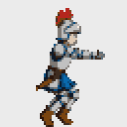
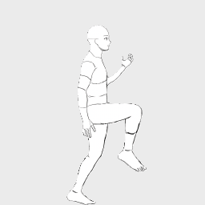

# ActSprite — 演出動作，直接遊玩

[](README.md)

> 黑客松：Meta Global AI Developer Hackathon · 賽道：Indie Developer · 主題：**Build for Your World**

用手機演出一個動作，取得角色一致、可直接在 Unity 使用的遊戲動畫。

**狀態：** 開發中。命令列已能執行完整處理流程，Unity 匯入工具也能把輸出的 ZIP 變成可操作的角色；完整網頁流程將接續完成。

## 評審：兩分鐘內完成驗證（不需要 API Key）

**1. 查看完成的輸出。** 每個 ZIP 都是處理流程實際交付給 Unity 的內容：

| 像素騎士：舞蹈（正面、48 幀）與跳躍（12 幀） | 像素獵犬：行走 | 線稿人物：跑步（20 幀）與攻擊 |
| --- | --- | --- |
|   |  |   |
| [下載 ZIP](https://github.com/lilwad-0730/actsprite/raw/main/examples/actsprite_knight.zip) | [下載 ZIP](https://github.com/lilwad-0730/actsprite/raw/main/examples/actsprite_hound.zip) | [下載 ZIP](https://github.com/lilwad-0730/actsprite/raw/main/examples/actsprite_lineman.zip) |
| 舞蹈：48 幀中有 40 幀通過全部檢查 | 10 幀中有 4 幀 | 跑步 20 幀中有 16 幀，攻擊 10 幀中有 6 幀 |
| 舞蹈：Meta API 呼叫費用 US$3.07 | US$1.01 | US$1.21 + US$0.53 |

騎士跳躍為額外的 GIF 預覽；騎士 ZIP 目前只包含舞蹈。

每個 ZIP 內含 Sprite Sheet、供 Unity 匯入工具使用的 `<name>_meta.json`、每一幀的 PNG、GIF
預覽，以及記錄每次重繪分數的 `report/scores.csv`（`needs_review` 代表該幀未通過所有檢查）。
費用是 `logs/cost.csv` 中每個 ZIP 背後所有付費呼叫的總和，包含 SAM 3.1 影片追蹤、角色設定圖，
以及每次重繪與檢查。10 幀的動作約需 4–6 分鐘（量測結果見 `spikes/REPORT.md`），48 幀的舞蹈約 15 分鐘。
獵犬和線稿人物的 ZIP 於 10/31 以 10 幀、15 fps 重新製作；費用只計新送出的呼叫（SAM 3.1 追蹤與部分重繪來自快取）。線稿人物的跑步於 11/1 以 20 幀、20 fps 加入。

**2. 執行測試。** 不需要金鑰或網路；`tests/test_examples.py` 會依輸出合約檢查三個 ZIP。

```powershell
python -m venv .venv
.venv\Scripts\python -m pip install -r requirements.txt
.venv\Scripts\python -m pytest
```

## 運作方式

| 步驟 | Meta 模型 | 工作 |
| --- | --- | --- |
| 擷取 | SAM 3.1（`sam-3.1`） | 追蹤影片中的表演者，取得每幀的像素遮罩 |
| 重繪 | Muse Image（`muse-image-1.0`） | 依角色重繪每個姿勢，以已核准的第一幀作為錨點，一次繪製第 1–7 幀 |
| 驗證 | Muse Spark 1.3（`muse-spark-1.3`）＋SAM 3.1 | 美術總監評分角色一致性；SAM 再次檢查姿勢剪影 |

## 快速開始（開發環境）

```powershell
python -m venv .venv
.venv\Scripts\python -m pip install -r requirements.txt
copy .env.example .env   # 接著將 Meta Model API Key 填入 .env
.venv\Scripts\python -m pytest
```

## 每個動作只需一行指令

```powershell
.venv\Scripts\python -m actsprite samples/attack.MOV --action attack --edges left,right             # 像素騎士
.venv\Scripts\python -m actsprite samples/pet.mp4 --action walk --actor dog --character hound         # 像素獵犬
.venv\Scripts\python -m actsprite my_jump.mp4 --action jump --sheet my_hero.png --style lineart --name hero
.venv\Scripts\python -m actsprite dance.mp4 --action dance --mode span --view front --frames 48 --edges top,bottom,left
```

每次執行都會使用 SAM 3.1 追蹤主角、挑選 8 個關鍵幀（跳躍／攻擊取一個爆發動作，待機取一個循環，
行走／跑步取兩步步態）、繪製姿勢導引、以 Muse Image 將每幀重繪成指定角色，並進行檢查
（SAM 3.1 剪影、Muse Spark 1.3 評審、調色盤與腿部動作）。未通過的幀最多重繪兩次。
第 1–7 幀會同時繪製，並以已核准的第 0 幀作為錨點。結果會新增為
`out/<name>/actsprite_<name>.zip` 中的一列：

```
actsprite_<name>/
  <name>_sheet.png                 每個動作一列、固定格子（像素風 128 px，其他風格 256 px）
  <name>_meta.json                 格子大小、腳底軸心（0.5, 0）及各動作的列、幀數、fps、循環設定
  frames/<action>/<action>_00.png  每一幀各自輸出為 PNG
  preview/<action>.gif
  report/scores.csv                每次重繪的分數；needs_review 標記需要檢查的幀
  report/summary.md
  reference/character_sheet.png
  reference/character_sheet_front.png   只在有動作使用 --view front 時輸出
```

面對鏡頭拍攝的動作（例如跳舞）可以用以下選項：

- `--view front`：角色改為正面朝向觀眾。會多一次 Muse Image 呼叫，把側面設定圖畫成同一角色的正面設定圖。
- `--mode span`：在整段影片（或 `--start`／`--end` 指定的秒數範圍）平均取幀，不只挑一段爆發動作或一個循環。
- `--frames N`：畫 N 幀（2–48，預設：待機 8、其他動作 10）。每幀含重繪約 US$0.03–0.10。
- `--fps`：播放速度（1–30），或用 `auto` 依影片原速播放。預設：待機 8、其他動作 15、span 為 `auto`。
- `--head-turn`：另外用 SAM 3.1 追蹤主角的臉（約 US$0.04），讓角色的頭跟著轉（正面、微轉、四分之三側、側面、背面）。姿勢導引會多一塊只有形狀、沒有五官的臉部色塊，重繪和評審都會收到一句頭部方向說明。使用 `--view front` 時預設開啟。
- `--sample-fps`：SAM 3.1 每秒追蹤幾張影格（1–60，預設 30，不會超過影片本身）。動作快又複雜、以 60 fps 拍攝時可以調高。

每批 API 呼叫前都會顯示預估費用，且每次呼叫都記錄於 `logs/cost.csv`（三個範例每個動作約
US$0.7；相同要求會直接使用 `cache/`，不再收費）。設定 `ACTSPRITE_OFFLINE=1` 後只會從快取回應：
不需要金鑰，也不會將任何內容傳送至 API。

## 評估

用作者自己的影片做的小規模開發檢查（11/1），每個數字都來自實際執行紀錄；細節、限制與重現指令見
[eval/README.md](eval/README.md)。

| 模型 | 實測結果 |
| --- | --- |
| Muse Image＋驗證迴圈 | 68 個關鍵幀中 79% 通過全部檢查；每幀只畫一次、不錨定第 0 幀時為 32%（E1） |
| Muse Spark 1.3 評審 | 19 張故意改壞的幀抓到 14 張（換色 5/5、少配件 5/5、多配件 4/4、比例錯誤 0/5），19 張正常幀誤判 1 張（E6） |
| SAM 3.1 | 10 段影片中 9 段有 90% 以上的幀追蹤到主角（E4） |
| 費用 | 8–12 幀的動作第一次生成約 US$0.5–1.0（E3） |

## Unity

匯入工具是一個 Unity 6 套件，放在 [`unity/ActSpriteImporter`](unity/ActSpriteImporter/README.md)。

1. Window > Package Manager > + > *Install package from git URL…*，輸入
   `https://github.com/lilwad-0730/actsprite.git?path=unity/ActSpriteImporter`
   （或選 *Install package from disk…*，指向本機 clone 裡的 `unity/ActSpriteImporter/package.json`）。
2. 選 **ActSprite > Import ZIP…**，挑上面任一個 ZIP。工具會切格（軸心在腳底）、依各動作的 fps 建立動畫，
   建立 Animator Controller（參數 `Speed`、`IsGrounded`，其他動作各一個 Trigger），以及含 Rigidbody2D
   和依角色像素貼合碰撞體的 Prefab。
3. 選 **ActSprite > Build Demo Scene**，按 Play。場景會先放出套件內附的像素騎士（待機、跑步、跳躍、攻擊），
   確保一定有會跑的角色；你匯入的角色排在它後面。A/D 移動、空白鍵跳躍、1–9 播放攻擊或舞蹈等其他動作、
   Tab 切換角色。

已用腳本在全新的 Unity 6000.5.5f1 空專案驗證（先用舊版 Input Manager，再改成只用 Input System）：
三個範例角色匯入時沒有任何警告；每段動畫的關鍵幀都依 fps 等距排列；內附騎士在 `Speed` > 0.1 時從待機切到跑步，
並依序播放 `run_00`–`run_07`；每個角色落到地面和兩個平台上，最低的腳底像素都剛好貼齊表面（誤差 0 像素）。
作者也已在 Play Mode 手動驗收（2026-10-31）。

## 網頁應用程式

線上版：https://huggingface.co/spaces/Andy0730huggin/actsprite 。上傳手機影片，選角色（內建或上傳自己的設計）和動作，
再依序走三個檢查步驟：**1. 追蹤**（只用 SAM 3.1，約 US$0.02，先看關鍵幀的姿勢線稿）、**2. 第一幀**（畫出並檢查第 0 幀）、
**3. 全部幀**（動畫預覽、每一幀的結果，以及給 Unity 匯入工具的 ZIP）。使用的設定會顯示在頁面上，也寫進 ZIP 的
`report/parameters.json`。用 **Start at** 和選填的 **End at** 選擇影片區間，最長 5 秒。
跳躍／攻擊有填結束時間時會使用整段，留白則自動挑動作最劇烈的部分；待機／走路／跑步則在所選區間內找循環。
走路／跑步至少需要兩個完整步態循環；片段太短或取樣稍有差異時，仍可能找不到循環。

| 動作 | 最多格數 | 播放速度 |
| --- | --- | --- |
| idle | 8 | 8 fps |
| walk / run | 16 | 依原影片時間計算 |
| jump | 12 | 依原影片時間計算 |
| attack | 10 | 15 fps |

追蹤最多取樣 30 fps。**Name** 同時設定 ZIP 檔名與內部角色名稱；完成後按 **Rename the ZIP (free)**
可免費重新打包，不會呼叫 Meta API。名稱最多 32 字，保留英數字、`-`、`_`，空白換成底線，其他字元移除。

每位訪客每天最多 5 次追蹤、2 次生成；Space 目前的花費紀錄達 US$40 時停止呼叫。
花費紀錄與每日次數可能隨 Space 重啟歸零，因此這不是持久的帳務上限。其他設定在網頁上鎖定，指令列版可調整。

11/1 本機三步驟實測：跳躍 7/12 格通過（US$0.80）、跑步 9/16（US$1.58）、攻擊 4/10（US$0.947636）。
這些是開發測試，不能保證其他素材的通過率；跳躍與跑步測試早於最新的讀片修正。攻擊是在修正方向後用直立畫面測試，
仍會把窄站姿畫成大跨步，使用前請檢查預覽與橘色未通過幀。先前 8 格版的 US$0.57、三步各 21／76／141 秒，
屬於舊設定的量測，不能代表目前各動作設定的時間。

```powershell
.venv\Scripts\python -m pip install gradio==6.31.0 spaces huggingface_hub
.venv\Scripts\python app.py                    # 本機：http://localhost:7860
.venv\Scripts\hf auth login                    # 只需一次，Token 保留在你的電腦
.venv\Scripts\python scripts/deploy_space.py   # 上傳 app.py、actsprite/、showcase/、characters/ 至 Space
```

## 黑客松期間完成（2026 年 10 月 26 日至 11 月 4 日）

這個儲存庫中的所有內容都在黑客松期間建立，詳情請見 Git 紀錄。
線稿角色設計（`man in line.jpg`）由作者的女朋友於 2026 年 10 月 29 日為本專案繪製。
Unity Demo 場景的地牢牆面與地板（`unity/ActSpriteImporter/DemoArt/`）由作者於 2026 年 10 月 30 日以 AI 圖像生成工具製作，
提示詞見 `DemoArt/GenerationPrompts.md`。
唯一的外部輸入是「致謝與授權」中列出的測試影片。

## 致謝與授權

| 套件 | 授權 | 用途 |
| --- | --- | --- |
| [openai](https://github.com/openai/openai-python) | Apache-2.0 | 連接相容 OpenAI 格式的 Meta Model API |
| [meta-sam-parser](https://pypi.org/project/meta-sam-parser/) | SAM License（Meta） | 官方 SAM 3.1 分割輸出解析器 |
| [opencv-python-headless](https://github.com/opencv/opencv-python) | Apache-2.0 | 影格擷取、邊緣偵測與遮罩運算 |
| [NumPy](https://numpy.org) | BSD-3-Clause | 陣列運算 |
| [Pillow](https://python-pillow.org) | MIT-CMU | 圖片讀寫、調色盤與打包 |
| [python-dotenv](https://github.com/theskumar/python-dotenv) | BSD-3-Clause | 載入 `.env` |
| [pytest](https://pytest.org) | MIT | 測試 |
| [Gradio](https://github.com/gradio-app/gradio) | Apache-2.0 | 網頁應用程式（`app.py`）；由 Space 依 `sdk_version` 安裝 |
| [spaces](https://pypi.org/project/spaces/) | Apache-2.0 | Hugging Face ZeroGPU 託管掛鉤（應用程式以 CPU 執行） |
| [huggingface_hub](https://github.com/huggingface/huggingface_hub) | Apache-2.0 | `scripts/deploy_space.py` 將應用程式上傳至 Space |
| [2D Sprite](https://docs.unity3d.com/Packages/com.unity.2d.sprite@1.0/manual/index.html)（Unity） | Unity Companion License | Unity 匯入工具：透過 Sprite Editor Data Provider API 切格 |
| [Input System](https://docs.unity3d.com/Packages/com.unity.inputsystem@1.19/manual/index.html)（Unity，選用） | Unity Companion License | 專案使用 Input System 時的鍵盤操作 |

| 影片 | 來源 | 授權 | 用途 |
| --- | --- | --- | --- |
| `samples/pet.mp4`（未收入儲存庫） | Luis Adolfo Burgos 於 Pexels 發布的 [Close-Up Shot of Dog Walking on the Street](https://www.pexels.com/video/close-up-shot-of-dog-walking-on-the-street-4300700/) | [Pexels License](https://www.pexels.com/license/)（可免費使用與修改） | 四足行走循環的測試輸入。儲存庫只收錄衍生剪影與重繪 Sprite；如需重現，請從連結下載影片。 |
| `samples/dance 2 test .mp4`（未收入儲存庫） | 作者的朋友拍攝 | 已取得舞者同意 | 像素騎士舞蹈範例的輸入。儲存庫只收錄重繪後的騎士 Sprite。 |

## 授權

MIT
