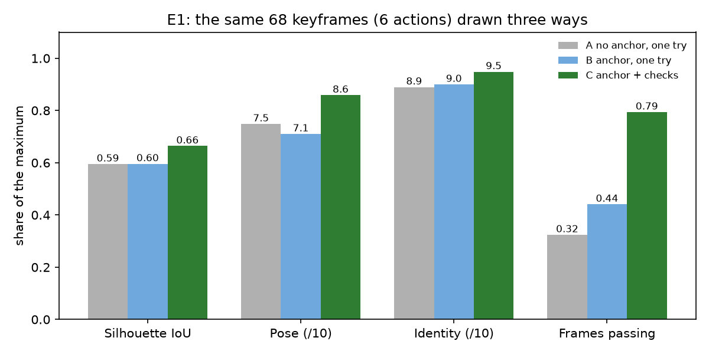

# Evaluation

A small development check on the author's own clips (Nov 1, 2026), not a formal accuracy study. Every number
below comes from a run recorded in `eval/results/`; nothing is estimated or filled in. Re-run with the commands
under each section (E1 and E6 call the Meta Model API and need a key; E3 and E4 only read local records).

E1 uses saved keyframes from before the uniform-time sampling update. Those measurements are historical;
image quality with the new sampling has not been re-evaluated. Local timing checks are in `out/_eval/timing/`.

| Model | What it does here | Measured result | Source |
| --- | --- | --- | --- |
| SAM 3.1 | Tracks the actor in the clip; segments every redraw for the silhouette check | 9 of 10 clips had a mask in at least 90% of the frames (E4) | `results/e4_tracking.csv` |
| Muse Image | Redraws each pose as the character, anchored on frame 0 | With the checks, 79% of 68 frames pass vs 32% for single drawings without an anchor (E1) | `results/e1_summary.csv` |
| Muse Spark 1.3 | Art-director critic: pose and identity scores, fix instructions | Rejected 14 of 19 deliberately broken frames and 1 of 19 good ones (E6) | `results/e6_frames.csv` |

## E1: anchor and verification loop

`python -m eval.e1_ablation`. The same 68 keyframes (6 actions: knight idle, run, jump; line-art man run,
attack; hound walk) drawn three ways and scored the same way:

| | Silhouette IoU | Pose (/10) | Identity (/10) | Frames passing |
| --- | --- | --- | --- | --- |
| A. No anchor, one try (sheet + pose guide only) | 0.595 | 7.5 | 8.9 | 32% |
| B. Anchor on frame 0, one try | 0.596 | 7.1 | 9.0 | 44% |
| C. Anchor + checks, up to 2 redraws (shipped) | **0.664** | **8.6** | **9.5** | **79%** |

Read with care:
- C keeps the best of up to three tries by these same scores, so part of its lead is selection: that is what the
  verification loop is for, but it is not three independent draws being compared.
- A's critic call has no reference frame (there is none); B's and C's compare against frame 0 as the pipeline does.
- IoU here is between the saved pose guide and the drawing's local cutout, for all three conditions alike; the
  pipeline itself uses a SAM 3.1 mask of the drawing. Leg-motion checks are left out, since A has no reference.
- Per action (`results/e1_summary.csv`) the anchor alone does not always help: for the knight jump and the line-art
  run, B scored below A. The gain comes mostly from the checked redraws.

## E3: cost

`python -m eval.e3_e4`. From `logs/cost.csv` (every paid call is logged) and each action's `result.json`.

| Sprite | Frames | Spend of the run that made it | All tries on this action, incl. earlier reruns |
| --- | --- | --- | --- |
| Knight run | 8 | $0.46 | $2.17 |
| Knight jump | 12 | $0.83 | $4.40 |
| Line-art man attack | 10 | $0.53 | $0.53 |
| Line-art man run | 20 | $0.21 (redraws partly cached) | $2.70 |
| Hound walk | 10 | $1.01 | $1.01 |
| Knight dance (front view) | 48 | $2.98 | $11.25 |

A first run of an 8–12 frame action costs about $0.5–1.0. Mean price per paid call: Muse Image $0.010, Muse Spark
critic $0.021, SAM 3.1 image $0.0025, SAM 3.1 video track $0.019 (`results/e3_cost_by_model.csv`). The whole
project's development spend so far is $43.58, including experiments.

## E4: tracking robustness

`python -m eval.e3_e4`; details in `results/e4_summary.md`. 10 clips: 9 of a person (the author or a friend, with
consent), 1 of a dog (Pexels). SAM 3.1 had a mask in at least 90% of the frames in 9 of them; the exception
(`attack.MOV`, 88%) has stretches without the actor in frame. Phone clips often cut the feet at the bottom edge, so several needed
`--edges left,right`. Not tested: a stop-motion figure, cluttered indoor scenes, more than one person.

## E6: defect injection (is the critic any good?)

`python -m eval.e6_defects`. 19 frames that passed in the shipped runs were edited by Muse Image to add one defect,
then both versions were judged by the same critic request the pipeline sends.

| Defect | Rejected by the critic |
| --- | --- |
| Recolour (e.g. gold armour) | 5/5 |
| Missing part (e.g. no sword) | 5/5 |
| Extra item (e.g. a cape) | 4/4 |
| Wrong proportions (e.g. a big head) | 0/5 |
| **Good frames rejected by mistake** | **1/19** |

Proportions are the weak spot, on both sides: in 3 of the 5 edits Muse Image barely changed the figure, and for the
hound with a clearly oversized head the critic named the problem ("head is oversized") but still scored 7, just
at the pass mark. Examples: `results/e6_examples.png` (good frames above, edited below).

## Not done

- **E2 (time against doing it by hand in Unity)** and **E5 (SAM masks against hand-drawn outlines)** need the
  author's own time and were not run.
- Skeleton guides (MediaPipe joints drawn on the pose guide) were tried on Nov 1 and made the drawings worse in
  6 of 7 frames: Muse Image still drew a wide stride over closed legs. Scripts: `spikes/spike_skeleton.py`,
  `spikes/spike_skeleton_anchor.py`.
